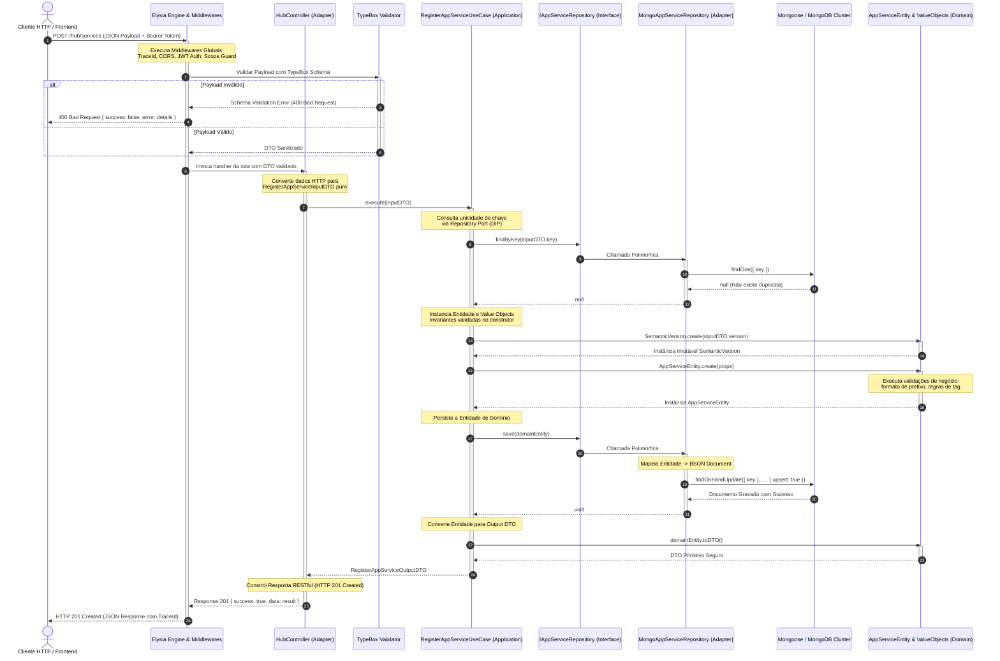

# Guia de Arquitetura em Camadas: M-Manage Hub & Clean Architecture

> **Documento Técnico:** Diretrizes de Engenharia e Padrão de Camadas  
> **Sistema:** `m-manage` (Central Hub de Aplicações e Microsserviços MirandaSoft / M-Platform)  
> **Versão:** `V0.10.56`  
> **Autor:** Tech Lead & Staff Systems Architect  
> **Status:** Referência Canônica de Engenharia  
> **Padrão Arquitetural:** Clean Architecture (Robert C. Martin) + Ports & Adapters (Hexagonal) + Modular Monolith

---

## 1. Visão Geral e Princípios Fundamentais

O ecossistema **m-manage** opera como o **Hub Central de Aplicações, Serviços e Identidades** da MirandaSoft. Ele agrega múltiplos domínios de negócio de alta criticidade — desde verticais SaaS (Studio BVA, M-Cursos LMS, ERP Industrial/Financeiro, Farmácia de Manipulação 4.0, Gastronomia) até serviços transversais (Autenticação Multi-Tenant, Auditoria, Marketplace de Aplicações e Mensageria Assíncrona via RabbitMQ).

Para viabilizar a evolução concorrente entre equipes, evitar o acoplamento espaguete e permitir testes unitários determinísticos com tempo de execução instantâneo no runtime **Bun**, o Hub adota formalmente os preceitos da **Clean Architecture**.

```mermaid
graph TD
    subgraph Layer4["4. Frameworks & Drivers (Mundo Exterior & I/O)"]
        direction TB
        ElysiaJS["ElysiaJS HTTP Engine / Bun Runtime"]
        MongoDB["MongoDB & Mongoose Driver"]
        RabbitMQ["RabbitMQ (amqplib) AMQP Broker"]
        RedisCluster["Redis Cache Client (ioredis)"]
        S3Storage["AWS S3 / MinIO Object Storage"]

        subgraph Layer3["3. Interface Adapters (Adaptadores de Entrada e Saída)"]
            direction TB
            Controllers["Controllers & Route Handlers"]
            TypeBoxSchemas["TypeBox Schemas & DTO Validators"]
            MongoRepos["Mongo Repositories Implementation"]
            EventConsumers["AMQP Consumers & Listeners"]
            Presenters["Mappers & Presenters (Entity -> DTO)"]

            subgraph Layer2["2. Use Cases (Application Layer / Regras da Aplicação)"]
                direction TB
                Interactors["Use Cases / Interactors (Commands & Queries)"]
                ApplicationDTOs["Application Input / Output DTOs"]
                OutputPorts["Repository Ports & Event Bus Interfaces"]
                DomainServices["Application Services & Orchestrators"]

                subgraph Layer1["1. Domain Entities (Enterprise Business Rules / Núcleo Puro)"]
                    direction TB
                    Entities["Domain Entities & Aggregates"]
                    ValueObjects["Immutable Value Objects (VOs)"]
                    DomainErrors["Domain Business Exceptions"]
                    RepositoryInterfaces["Repository Contracts (Interfaces Puras)"]
                end
            end
        end
    end

    Layer4 --> Layer3
    Layer3 --> Layer2
    Layer2 --> Layer1
```



### 1.1. A Regra de Dependência (The Dependency Rule)
> **Princípio Sagrado:** O fluxo de dependências do código-fonte aponta **exclusivamente de fora para dentro**.

1. As camadas internas **desconhecem absolutamente** as camadas externas.
2. A camada de **Domínio** não possui qualquer menção a frameworks, bibliotecas HTTP (Elysia), drivers de banco (Mongoose) ou brokers de mensagens (amqplib).
3. A camada de **Aplicação (Use Cases)** depende apenas de interfaces abstratas (*Ports*) definidas pelo domínio ou pela própria aplicação.
4. Frameworks externos e bibliotecas terceiras atuam estritamente como **detalhes de implementação voláteis**, intercambiáveis sem que uma linha sequer de regra de negócio seja alterada.

### 1.2. Inversão de Dependência (DIP - Dependency Inversion Principle)
Módulos de alto nível (Casos de Uso) não dependem de módulos de baixo nível (Mongoose/MongoDB). Ambos dependem de abstrações (Interfaces/Ports). Abstrações não dependem de detalhes; detalhes dependem de abstrações.

---

## 2. Detalhamento Técnico das 4 Camadas

Abaixo está o detalhamento granular de cada camada, suas responsabilidades exclusivas, o que é permitido e o que é expressamente proibido.

```
┌────────────────────────────────────────────────────────────────────────┐
│ 4. Frameworks & Drivers: Bun, Elysia, Mongoose, Redis, RabbitMQ, S3    │
│  ┌──────────────────────────────────────────────────────────────────┐  │
│  │ 3. Interface Adapters: Controllers, MongoRepos, TypeBox Schemas  │  │
│  │  ┌────────────────────────────────────────────────────────────┐  │  │
│  │  │ 2. Use Cases: Commands, Queries, Application DTOs, Ports   │  │  │
│  │  │  ┌──────────────────────────────────────────────────────┐  │  │  │
│  │  │  │ 1. Domain Entities: Entities, Value Objects, Errors  │  │  │  │
│  │  │  └──────────────────────────────────────────────────────┘  │  │  │
│  │  └────────────────────────────────────────────────────────────┘  │  │
│  └──────────────────────────────────────────────────────────────────┘  │
└────────────────────────────────────────────────────────────────────────┘
```

---

### 2.1. Camada 1: Domain Entities (Núcleo Corporativo & Invariantes de Negócio)

A camada de Domínio é o coração do sistema. Ela expressa a linguagem ubíqua do negócio (DDD) e contém as regras corporativas fundamentais que existiriam mesmo que o software não operasse sobre uma interface Web.

#### Responsabilidades
- **Entidades e Agregados (`entities/`):** Objetos com identidade única que encapsulam estado e mutações de negócio, protegendo suas invariantes.
- **Objetos de Valor (`valueObjects/`):** Objetos imutáveis sem identidade própria, definidos inteiramente por suas propriedades e dotados de auto-validação instantânea (ex: `SemanticVersion`, `ServiceStatus`, `Cpf`, `Cnpj`, `Money`).
- **Exceções de Domínio (`errors/`):** Erros de negócio tipados com mensagens explicativas que representam violações de regras corporativas (ex: `InvalidSemanticVersionError`, `DuplicateServiceKeyError`).
- **Contratos de Repositório (`repositories/`):** Interfaces TypeScript puras que definem os métodos necessários para persistir e buscar agregados, sem vincular contratos a estruturas de bancos específicos.

#### Regras Rígidas de Engenharia
- **Zero Dependências Externas:** Apenas TypeScript nativo. Proibido importar `elysia`, `mongoose`, `@sinclair/typebox`, `jsonwebtoken` ou módulos do Node/Bun.
- **Invariantes Fail-Fast:** Nenhuma entidade ou Value Object pode existir em estado inconsistente ou inválido. Se os dados de entrada violam as regras, uma exceção de domínio é lançada imediatamente no construtor/fábrica.

#### Exemplo de Código do Hub:
```typescript
// src/hub/domain/valueObjects/semanticVersion.vo.ts
import { InvalidSemanticVersionError } from '../errors/hub.errors';

export class SemanticVersion {
    private static readonly SEMVER_REGEX = /^v?(\d+)\.(\d+)(?:\.(\d+))?(?:-([0-9A-Za-z.-]+))?$/;

    private readonly _major: number;
    private readonly _minor: number;
    private readonly _patch: number;
    private readonly _prerelease?: string;
    private readonly _raw: string;

    private constructor(raw: string, major: number, minor: number, patch: number, prerelease?: string) {
        this._raw = raw;
        this._major = major;
        this._minor = minor;
        this._patch = patch;
        this._prerelease = prerelease;
        Object.freeze(this); // Imutabilidade profunda
    }

    public static create(version: string): SemanticVersion {
        if (!version || typeof version !== 'string') {
            throw new InvalidSemanticVersionError(String(version));
        }
        const trimmed = version.trim();
        const match = this.SEMVER_REGEX.exec(trimmed);
        if (!match) throw new InvalidSemanticVersionError(trimmed);

        const major = parseInt(match[1], 10);
        const minor = parseInt(match[2], 10);
        const patch = match[3] !== undefined ? parseInt(match[3], 10) : 0;
        return new SemanticVersion(trimmed, major, minor, patch, match[4]);
    }

    public get value(): string { return this._raw; }
    public isNewerThan(other: SemanticVersion): boolean {
        if (this._major !== other._major) return this._major > other._major;
        if (this._minor !== other._minor) return this._minor > other._minor;
        return this._patch > other._patch;
    }
}
```

---

### 2.2. Camada 2: Use Cases (Application Layer / Orquestração da Aplicação)

A camada de Aplicação contém os casos de uso específicos do software. Ela orquestra a execução das regras de negócio, coordenando a entrada de dados, a consulta a repositórios abstratos, a chamada de métodos de domínio nas entidades e a publicação de eventos.

#### Responsabilidades
- **Casos de Uso / Interactors (`useCases/`):** Cada caso de uso representa uma ação unitária do usuário ou do sistema (princípio da responsabilidade única - SRP). Exemplos: `RegisterAppServiceUseCase`, `GetHubManifestUseCase`, `VerifyServiceHealthUseCase`.
- **Application DTOs (`dtos/`):** Objetos de transferência puros (estruturas tipadas de entrada e saída) que desacoplam a camada de apresentação das entidades de domínio internas.
- **Portas de Saída (Ports):** Definições abstratas para envio de e-mails, publicação em tópicos de mensageria (`IEventPublisher`), gravação de logs ou chamadas a gateways externos.

#### Regras Rígidas de Engenharia
- Use Cases conhecem apenas a **Camada 1 (Domínio)**.
- Não possuem qualquer dependência de `elysia`, `Context`, `Request`, `Response`, `Mongoose` ou `Express`.
- Recebem suas dependências (repositórios e gateways) obrigatoriamente via construtor (Injeção de Dependências).
- Facilitam testes unitários puros com repositórios em memória (*In-Memory Stubs*), sem necessidade de subir MongoDB ou emuladores.

#### Exemplo de Código do Hub:
```typescript
// src/hub/application/useCases/registerAppService.useCase.ts
import { AppServiceEntity } from '../../domain/entities/appService.entity';
import { SemanticVersion } from '../../domain/valueObjects/semanticVersion.vo';
import { ServiceStatus } from '../../domain/valueObjects/serviceStatus.vo';
import { IAppServiceRepository } from '../../domain/repositories/appService.repository.interface';
import { DuplicateServiceKeyError } from '../../domain/errors/hub.errors';

export interface RegisterAppServiceInputDTO {
    key: string;
    name: string;
    prefix: string;
    version: string;
    status?: string;
    description?: string;
    tags?: string[];
}

export interface RegisterAppServiceOutputDTO {
    id: string;
    key: string;
    name: string;
    prefix: string;
    version: string;
    status: string;
    createdAt: string;
}

export class RegisterAppServiceUseCase {
    constructor(private readonly appServiceRepo: IAppServiceRepository) {}

    public async execute(input: RegisterAppServiceInputDTO): Promise<RegisterAppServiceOutputDTO> {
        const existing = await this.appServiceRepo.findByKey(input.key);
        if (existing) {
            throw new DuplicateServiceKeyError(input.key);
        }

        const domainEntity = AppServiceEntity.create({
            key: input.key,
            name: input.name,
            prefix: input.prefix,
            version: SemanticVersion.create(input.version),
            status: ServiceStatus.create(input.status || 'active'),
            description: input.description,
            tags: input.tags,
        });

        await this.appServiceRepo.save(domainEntity);

        const dto = domainEntity.toDTO();
        return {
            id: dto.id,
            key: dto.key,
            name: dto.name,
            prefix: dto.prefix,
            version: dto.version,
            status: dto.status,
            createdAt: dto.createdAt,
        };
    }
}
```

---

### 2.3. Camada 3: Interface Adapters (Adaptadores de Entrada e Saída)

A camada de adaptadores atua como a tradutora universal entre o mundo exterior e os casos de uso. Ela converte dados em formatos convenientes para a aplicação e vice-versa.

#### Responsabilidades
- **Controllers HTTP (`infrastructure/http/*.controller.ts`):** Recebem as requisições do Elysia, extraem parâmetros/headers/body validados, chamam o Caso de Uso apropriado e formatam a resposta HTTP (`status`, `headers`, `JSON`).
- **Validação e Schemas (`infrastructure/http/*.schema.ts`):** Definições de contrato HTTP usando `@sinclair/typebox` para validação fail-fast de payloads no gateway HTTP antes de atingir a aplicação.
- **Implementações de Repositório (`infrastructure/persistence/mongo.*.repository.ts`):** Implementam as interfaces da Camada 1 (`IAppServiceRepository`) utilizando o Mongoose, convertendo documentos BSON/Mongo em Entidades de Domínio e vice-versa (*Data Mapper Pattern*).
- **Consumidores de Mensageria (`infrastructure/consumers/`):** Escutam filas do RabbitMQ, desserializam payloads e invocam os Use Cases adequados.

#### Exemplo de Repositório Mongoose Desacoplado:
```typescript
// src/hub/infrastructure/persistence/mongoAppService.repository.ts
import { IAppServiceRepository } from '../../domain/repositories/appService.repository.interface';
import { AppServiceEntity } from '../../domain/entities/appService.entity';
import { SemanticVersion } from '../../domain/valueObjects/semanticVersion.vo';
import { ServiceStatus } from '../../domain/valueObjects/serviceStatus.vo';
import { AppServiceModel } from './appService.mongoose.model';

export class MongoAppServiceRepository implements IAppServiceRepository {
    public async findByKey(key: string): Promise<AppServiceEntity | null> {
        const doc = await AppServiceModel.findOne({ key: key.toLowerCase() }).lean().exec();
        if (!doc) return null;

        return AppServiceEntity.reconstitute({
            id: doc._id.toString(),
            key: doc.key,
            name: doc.name,
            prefix: doc.prefix,
            version: SemanticVersion.create(doc.version),
            status: ServiceStatus.create(doc.status),
            description: doc.description,
            tags: doc.tags,
            createdAt: doc.createdAt,
            updatedAt: doc.updatedAt,
        });
    }

    public async save(entity: AppServiceEntity): Promise<void> {
        const raw = entity.toDTO();
        await AppServiceModel.findOneAndUpdate(
            { key: raw.key },
            {
                $set: {
                    name: raw.name,
                    prefix: raw.prefix,
                    version: raw.version,
                    status: raw.status,
                    description: raw.description,
                    tags: raw.tags,
                    updatedAt: new Date(),
                },
                $setOnInsert: {
                    createdAt: new Date(),
                }
            },
            { upsert: true, new: true }
        ).exec();
    }
}
```

---

### 2.4. Camada 4: Frameworks & Drivers (Infraestrutura Concreta & I/O)

Esta é a camada mais externa do sistema, onde residem os detalhes concretos de infraestrutura, os drivers de terceiros e os frameworks web.

#### Componentes no M-Manage Hub:
- **ElysiaJS / Bun Engine:** O servidor HTTP ultrarrápido que roteia chamadas de rede para os controllers.
- **MongoDB & Mongoose Native:** Conexões com o cluster de banco, definições de schemas Mongoose com tipos do banco de dados, índices e opções de sharding/replica-set.
- **RabbitMQ (amqplib):** Inicialização de conexões AMQP, canais, exchanges (`direct`, `topic`, `fanout`), dead-letter exchanges (DLX) e assert de filas.
- **Redis (ioredis):** Cache distribuído e locks otimistas / chaves de idempotência.
- **AWS S3 SDK:** Storage distribuído de binários e mídias.

#### Características Fundamentais:
- Esta camada é puramente **plugável**. Se decidirmos trocar o Elysia por Fastify ou o MongoDB por PostgreSQL com Drizzle/Prisma, **as camadas 1 e 2 permanecerão 100% intactas**, sem alteração de uma única linha de regra de negócio ou caso de uso.

---

## 3. Diagrama de Sequência: Ciclo de Vida de uma Requisição

O diagrama abaixo detalha o fluxo completo de ponta a ponta quando um cliente HTTP submete uma requisição ao Hub (exemplo: registro ou consulta de um serviço de vertical SaaS).



---

## 4. Matriz de Responsabilidades & Regras de Dependência (Do's and Don'ts)

| Camada | O que PODE importar | O que NÃO PODE importar | Onde fica localizada |
| :--- | :--- | :--- | :--- |
| **1. Domain Entities** | Tipos primitivos, utilitários puros de domínio, outros Value Objects do mesmo domínio. | `elysia`, `mongoose`, `@sinclair/typebox`, `jsonwebtoken`, `amqplib`, camada de aplicação ou infraestrutura. | `src/modules/<contexto>/domain/` |
| **2. Use Cases (Application)** | Camada de Domínio (`domain/`), DTOs internos, bibliotecas utilitárias sem estado (ex: criptografia pura, se isolada). | `elysia`, `Context`, `MongooseModel`, banco de dados físico, conexões de rede ativas. | `src/modules/<contexto>/application/` |
| **3. Interface Adapters** | Camada de Aplicação (`application/`), Camada de Domínio (`domain/`), bibliotecas de validação (`TypeBox`), drivers de banco (`Mongoose`). | Não deve acoplar a infraestrutura física diretamente ao domínio sem passar por mapeamento de DTO/Entity. | `src/modules/<contexto>/infrastructure/` |
| **4. Frameworks & Drivers** | Todas as bibliotecas de I/O, configurações de servidor, variáveis de ambiente, plugins externos. | Regras de negócio não devem ser escritas inline em arquivos de configuração ou rotas. | `src/config/`, `src/index.ts`, `src/hub/` |

---

## 5. Guia Prático: Como Implementar um Novo Bounded Context no Hub

Siga este procedimento passo a passo para criar uma nova vertical de negócio no Hub mantendo o padrão arquitetural intacto e aprovado pelo Tech Lead.

### Passo 1: Criar a Estrutura de Pastas Canônica
Suponha a criação de um novo contexto para gestão de faturamento (`billing`):

```bash
mkdir -p src/modules/billing/domain/entities
mkdir -p src/modules/billing/domain/valueObjects
mkdir -p src/modules/billing/domain/repositories
mkdir -p src/modules/billing/domain/errors
mkdir -p src/modules/billing/application/useCases
mkdir -p src/modules/billing/application/dtos
mkdir -p src/modules/billing/infrastructure/persistence
mkdir -p src/modules/billing/infrastructure/http
```

---

### Passo 2: Definir as Entidades e Value Objects no Domínio

Crie a exceção de domínio e a entidade com encapsulamento rigoroso:

```typescript
// src/modules/billing/domain/errors/billing.errors.ts
export class InvalidInvoiceAmountError extends Error {
    constructor(amount: number) {
        super(`O valor da fatura deve ser estritamente positivo. Informado: ${amount}`);
        this.name = 'InvalidInvoiceAmountError';
    }
}
```

```typescript
// src/modules/billing/domain/entities/invoice.entity.ts
import { InvalidInvoiceAmountError } from '../errors/billing.errors';

export interface InvoiceProps {
    id?: string;
    clientId: string;
    amountCents: number;
    status: 'draft' | 'issued' | 'paid' | 'cancelled';
    dueDate: Date;
    createdAt?: Date;
}

export class InvoiceEntity {
    private readonly _id?: string;
    private readonly _clientId: string;
    private _amountCents: number;
    private _status: 'draft' | 'issued' | 'paid' | 'cancelled';
    private _dueDate: Date;
    private readonly _createdAt: Date;

    private constructor(props: InvoiceProps) {
        if (props.amountCents <= 0) {
            throw new InvalidInvoiceAmountError(props.amountCents);
        }
        this._id = props.id;
        this._clientId = props.clientId;
        this._amountCents = props.amountCents;
        this._status = props.status;
        this._dueDate = props.dueDate;
        this._createdAt = props.createdAt || new Date();
    }

    public static create(props: InvoiceProps): InvoiceEntity {
        return new InvoiceEntity(props);
    }

    public markAsPaid(): void {
        if (this._status === 'cancelled') {
            throw new Error('Não é possível liquidar uma fatura cancelada.');
        }
        this._status = 'paid';
    }

    public get status(): string { return this._status; }
    public get amountCents(): number { return this._amountCents; }

    public toDTO() {
        return {
            id: this._id,
            clientId: this._clientId,
            amountCents: this._amountCents,
            status: this._status,
            dueDate: this._dueDate.toISOString(),
            createdAt: this._createdAt.toISOString(),
        };
    }
}
```

---

### Passo 3: Definir a Interface do Repositório (Port)

```typescript
// src/modules/billing/domain/repositories/invoice.repository.interface.ts
import { InvoiceEntity } from '../entities/invoice.entity';

export interface IInvoiceRepository {
    findById(id: string): Promise<InvoiceEntity | null>;
    save(invoice: InvoiceEntity): Promise<InvoiceEntity>;
    listByClient(clientId: string): Promise<InvoiceEntity[]>;
}
```

---

### Passo 4: Implementar o Caso de Uso (Application)

```typescript
// src/modules/billing/application/useCases/createInvoice.useCase.ts
import { InvoiceEntity } from '../../domain/entities/invoice.entity';
import { IInvoiceRepository } from '../../domain/repositories/invoice.repository.interface';

export interface CreateInvoiceInputDTO {
    clientId: string;
    amountCents: number;
    dueDate: string;
}

export interface CreateInvoiceOutputDTO {
    id?: string;
    clientId: string;
    amountCents: number;
    status: string;
    dueDate: string;
    createdAt: string;
}

export class CreateInvoiceUseCase {
    constructor(private readonly invoiceRepository: IInvoiceRepository) {}

    public async execute(input: CreateInvoiceInputDTO): Promise<CreateInvoiceOutputDTO> {
        const invoice = InvoiceEntity.create({
            clientId: input.clientId,
            amountCents: input.amountCents,
            dueDate: new Date(input.dueDate),
            status: 'draft',
        });

        const saved = await this.invoiceRepository.save(invoice);
        return saved.toDTO();
    }
}
```

---

### Passo 5: Implementar o Adaptador de Persistência (Mongoose Repo)

```typescript
// src/modules/billing/infrastructure/persistence/mongoInvoice.repository.ts
import { IInvoiceRepository } from '../../domain/repositories/invoice.repository.interface';
import { InvoiceEntity } from '../../domain/entities/invoice.entity';
import mongoose, { Schema, Document } from 'mongoose';

interface InvoiceDoc extends Document {
    clientId: string;
    amountCents: number;
    status: 'draft' | 'issued' | 'paid' | 'cancelled';
    dueDate: Date;
    createdAt: Date;
}

const InvoiceMongooseSchema = new Schema<InvoiceDoc>({
    clientId: { type: String, required: true, index: true },
    amountCents: { type: Number, required: true },
    status: { type: String, required: true, default: 'draft' },
    dueDate: { type: Date, required: true },
    createdAt: { type: Date, default: Date.now },
});

export const InvoiceModel = mongoose.models.Invoice || mongoose.model<InvoiceDoc>('Invoice', InvoiceMongooseSchema);

export class MongoInvoiceRepository implements IInvoiceRepository {
    public async findById(id: string): Promise<InvoiceEntity | null> {
        const doc = await InvoiceModel.findById(id).lean().exec();
        if (!doc) return null;
        return InvoiceEntity.create({
            id: doc._id.toString(),
            clientId: doc.clientId,
            amountCents: doc.amountCents,
            status: doc.status,
            dueDate: doc.dueDate,
            createdAt: doc.createdAt,
        });
    }

    public async save(invoice: InvoiceEntity): Promise<InvoiceEntity> {
        const dto = invoice.toDTO();
        const doc = await InvoiceModel.create({
            clientId: dto.clientId,
            amountCents: dto.amountCents,
            status: dto.status,
            dueDate: new Date(dto.dueDate),
        });
        return InvoiceEntity.create({
            id: doc._id.toString(),
            clientId: doc.clientId,
            amountCents: doc.amountCents,
            status: doc.status,
            dueDate: doc.dueDate,
            createdAt: doc.createdAt,
        });
    }

    public async listByClient(clientId: string): Promise<InvoiceEntity[]> {
        const docs = await InvoiceModel.find({ clientId }).lean().exec();
        return docs.map(d => InvoiceEntity.create({
            id: d._id.toString(),
            clientId: d.clientId,
            amountCents: d.amountCents,
            status: d.status,
            dueDate: d.dueDate,
            createdAt: d.createdAt,
        }));
    }
}
```

---

### Passo 6: Implementar o Controller Elysia com TypeBox

```typescript
// src/modules/billing/infrastructure/http/billing.controller.ts
import { Elysia, t } from 'elysia';
import { CreateInvoiceUseCase } from '../../application/useCases/createInvoice.useCase';
import { MongoInvoiceRepository } from '../persistence/mongoInvoice.repository';

// Composition Root local do módulo
const invoiceRepo = new MongoInvoiceRepository();
const createInvoiceUseCase = new CreateInvoiceUseCase(invoiceRepo);

export const billingRoutes = new Elysia({ prefix: '/billing' })
    .post(
        '/',
        async ({ body, set }) => {
            try {
                const result = await createInvoiceUseCase.execute(body);
                set.status = 201;
                return { success: true, data: result };
            } catch (err: any) {
                set.status = 400;
                return { success: false, error: err.message };
            }
        },
        {
            body: t.Object({
                clientId: t.String({ minLength: 1 }),
                amountCents: t.Integer({ minimum: 1 }),
                dueDate: t.String({ format: 'date-time' }),
            }),
        }
    );
```

---

### Passo 7: Registrar o Serviço no Hub Registry

Para que a nova vertical apareça no manifesto dinâmico `GET /hub/manifest` e no monitoramento de saúde `GET /hub/health`, registre-a em `src/hub/hub.registry.ts`:

```typescript
// Em src/hub/hub.registry.ts, na lista de services:
billing: {
    name: 'Billing & Invoicing',
    description: 'Gestão de Faturamento, Boletos e Assinaturas Multi-Tenant',
    prefix: '/billing',
    status: 'active',
    version: '1.0.0',
    tags: ['finance', 'billing', 'invoices'],
}
```

---

## 6. Padrão de Injeção de Dependências e Bootstrapping

No ecossistema Bun + Elysia do `m-manage`, optamos por **Pure Dependency Injection (Injeção Manual / Composition Root)** em vez de frameworks pesados de reflexão/decorators (como inversify ou NestJS):

### Por que Pure DI?
1. **Performance Absoluta:** Zero overhead em tempo de execução, zero decorators experimentais que degradam compilação.
2. **Tempo de Inicialização Sub-Milissegundo:** O Bun sobe a aplicação inteira em menos de 10ms.
3. **Tipagem Estrita e Completa:** Erros de injeção são detectados em tempo de compilação pelo compilador TypeScript.
4. **Facilidade Extrema em Testes:** Em testes unitários, basta passar um objeto simples que implemente a interface do repositório (`new CreateInvoiceUseCase(new InMemoryInvoiceRepo())`).

---

## 7. Estratégia de Testes por Camada

A Clean Architecture permite uma pirâmide de testes altamente eficiente e determinística:

```
          / \
         /   \     E2E / API Tests (Elysia .handle)
        /     \    - Testa integração de rede, rotas e serialização
       /───────\
      /         \    Integration Tests (Repositórios Mongoose)
     /           \   - Testa queries reais, índices e atomicidade
    /─────────────\
   /               \   Unit Tests Puros (Domínio & Use Cases)
  /                 \  - Zero dependências de I/O, execução em microssegundos
 /───────────────────\
```

- **Domain Tests:** Testam entidades, agregados e Value Objects. Não usam nenhum mock.
- **Use Case Tests:** Testam fluxos de negócio usando implementações em memória de repositórios (*Stubs/Spies*).
- **Repository Integration Tests:** Validam conversão BSON <-> Entity com uma base MongoDB efêmera de teste.
- **E2E Controller Tests:** Usam `app.handle(new Request('/hub/...'))` para validar códigos HTTP, cabeçalhos e validações de esquema.
