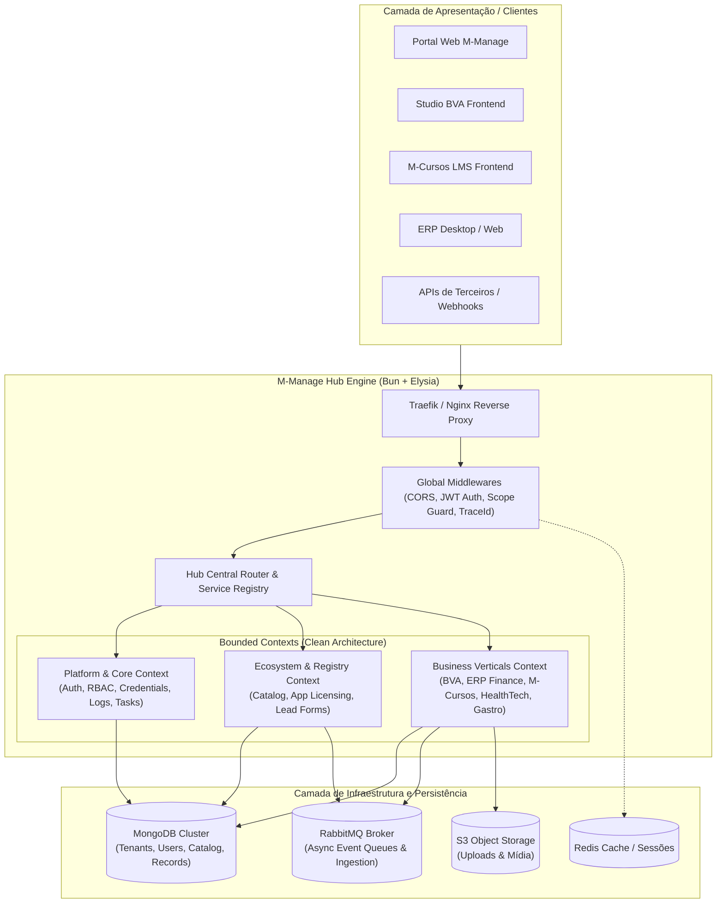
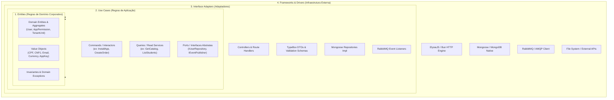

# Especificação Arquitetural: M-Manage App & Services Hub (Clean Architecture)

> **Documento:** Especificação Arquitetural e Diretrizes de Engenharia  
> **Sistema:** `m-manage` (Plataforma Hub de Aplicações e Microsserviços)  
> **Versão de Referência:** V0.10.52  
> **Status:** Aprovado para Planejamento e Refatoração Gradual  
> **Padrão Arquitetural:** Clean Architecture (Robert C. Martin) + Modular Monolith / Bounded Contexts

---

## 1. Visão Executiva e Propósito do Hub

O `m-manage` foi desenhado para evoluir de uma API monolítica tradicional para o **Hub Central de Aplicações e Serviços do ecossistema MirandaSoft / M-Platform**.

O Hub desempenha quatro papéis estratégicos essenciais:
1. **Identity & Access Gateway:** Autenticação centralizada JWT com granularidade multi-tenant por aplicação (`mAppAccess`).
2. **App Store & Service Registry:** Catálogo dinâmico de aplicações, provisionamento de licenças e marketplace corporativo.
3. **Core Services Engine:** Execução e exposição de APIs verticais de negócio (ERP, EAD LMS, Farmácia/HealthTech, Gastronomia, CRM/Leads, CMS).
4. **Event & Message Broker:** Hub de ingestão assíncrona orientada a eventos via RabbitMQ e orquestração de rotinas batch/tarefas.



---

## 2. Alinhamento com Clean Architecture

Para garantir testabilidade desacoplada, alta manutenibilidade e independência de frameworks ou banco de dados, cada módulo do Hub segue rigorosamente as 4 camadas concêntricas da **Clean Architecture**:



### Regras de Dependência Fundamentais:
1. **Regra de Ouro da Clean Architecture:** O fluxo de dependência aponta exclusivamente de fora para dentro. As camadas internas **nunca** importam nem conhecem nada das camadas externas.
2. **Entidades de Domínio puras:** Não contêm referências a Mongoose, Elysia ou decorators de bibliotecas terceiras. São classes ou tipos TypeScript puros contendo validações invariantes.
3. **Casos de Uso (Use Cases) acoplados apenas a Interfaces (Ports):**
   - Um caso de uso `RegisterCourseEnrollment` recebe um contrato `ICourseRepository` e `IEventBus`, nunca o modelo direto do Mongoose.
4. **Inversão de Dependência (DIP):** A infraestrutura implementa as interfaces definidas pelo Domínio/Aplicação.

---

## 3. Topologia e Estrutura dos Bounded Contexts

Cada módulo funcional dentro de `src/modules/<modulo>` é tratado como um *Bounded Context* autocontido, organizado internamente com a seguinte anatomia padrão:

```
src/modules/<contexto>/
├── domain/                      # CAMADA 1: Entidades e Contratos Puros
│   ├── entities/                # Entidades e Agregados de negócio
│   ├── valueObjects/            # Objetos de valor com validação invariante (ex: Cpf, Money)
│   ├── repositories/            # Interfaces de Repositório (Ports de saída)
│   └── errors/                  # Exceções de Domínio especializadas
│
├── application/                 # CAMADA 2: Casos de Uso e Orquestração
│   ├── useCases/                # Interactors (1 classe/função por caso de uso)
│   ├── dtos/                    # Contratos de entrada e saída da aplicação
│   └── services/                # Serviços de domínio quando múltiplos agregados interagem
│
└── infrastructure/              # CAMADAS 3 & 4: Adaptadores, Frameworks e Persistência
    ├── persistence/             # Schemas Mongoose e Implementações de Repositório
    │   ├── mongoose.schema.ts
    │   └── mongo.<contexto>.repository.ts
    ├── http/                    # Handlers Elysia e Schemas TypeBox
    │   ├── <contexto>.controller.ts
    │   └── <contexto>.schema.ts
    └── consumers/               # Listeners de fila RabbitMQ (quando aplicável)
```

### 3.1. Classificação dos Domínios no Hub

| Domínio de Alto Nível | Bounded Contexts | Descrição e Escopo |
| :--- | :--- | :--- |
| **Platform Hub (Core)** | `auth`<br/>`adminClients`<br/>`credentials`<br/>`logs`<br/>`tasks` | Gestão de identidades globais, usuários, chaves de API por cliente, logs de auditoria e agendador de tarefas concorrentes. |
| **Ecosystem & Licensing** | `catalog`<br/>`apps`<br/>`clientForms`<br/>`mLeadsRequest` | Vitrine de aplicações (Marketplace), provisionamento e verificação de licenças (`mAppAccess`), ingestão assíncrona de formulários e leads via AMQP. |
| **Business Verticals (SaaS)** | `bva`<br/>`mCursos`<br/>`erp`<br/>`erpFinance`<br/>`healthtech`<br/>`restaurant`<br/>`blogs`<br/>`content` | Módulos especializados que atendem a verticais específicas (Moda/Catálogo, Educação EAD, ERP Industrial e Financeiro, Farmácia de Manipulação 4.0, Gastronomia e CMS). |

---

## 4. O Hub Registry e Discovery Engine

O Hub implementa um **Service & App Registry** unificado que expõe metadados sobre capacidade, status de saúde e rotas ativas.

### 4.1. Contrato da Rota de Descoberta: `GET /hub/manifest`

Retorna a topologia ativa do cluster para auto-configuração de frontends e gateways:

```json
{
  "hub": {
    "name": "m-manage-hub",
    "version": "0.10.52",
    "environment": "production",
    "status": "healthy"
  },
  "domains": {
    "platform": {
      "prefix": "/auth",
      "modules": ["auth", "adminClients", "credentials", "logs", "tasks"],
      "status": "active"
    },
    "ecosystem": {
      "prefix": "/catalog",
      "modules": ["catalog", "apps", "clientForms"],
      "status": "active"
    },
    "services": {
      "bva": { "prefix": "/bva", "status": "active", "version": "1.2" },
      "mCursos": { "prefix": "/m-cursos", "status": "active", "version": "2.0" },
      "erpFinance": { "prefix": "/erp-finance", "status": "active", "version": "1.0" },
      "healthtech": { "prefix": "/healthtech", "status": "active", "version": "1.1" },
      "restaurant": { "prefix": "/restaurant", "status": "active", "version": "1.0" }
    }
  }
}
```

---

## 5. Diretrizes de Segurança, Resiliência e Observabilidade

### 5.1. Segurança (Zero-Trust Inter-Module)
- **Token JWT com Escopos por App (`mAppAccess`):** Um usuário autenticado no Hub só tem autorização para interagir com uma vertical SaaS se possuir registro ativo no agregador de licenças (`appKey` + `role`).
- **Validação Fail-Fast:** Schemas de entrada com TypeBox validam rigorosamente tipos, comprimentos e formatos antes que o payload atinja a camada de aplicação.

### 5.2. Resiliência e Idempotência
- **Consumer RabbitMQ:** Todo processamento de mensagens no broker implementa chaves de idempotência armazenadas no MongoDB/Redis para garantir execução sem duplicações (*at-least-once with idempotent handling*).
- **Graceful Shutdown:** Manipulação de `SIGINT`/`SIGTERM` fecha ordenadamente canais RabbitMQ, conexões Mongoose e cancela jobs em background.

### 5.3. Observabilidade
- **Correlation ID (Trace ID):** Cada requisição HTTP ou evento AMQP recebe/propaga `x-trace-id` nos logs estruturados JSON.
- **Health Checks Especializados:** `GET /health` reporta o status detalhado da conexão com MongoDB e RabbitMQ de forma não bloqueante.

---

## 6. Plano de Migração Gradual e Conservador

Seguindo o princípio de estabilidade em produção sem interrupções bruscas (*Strangler Fig Pattern*):

1. **Fase 1 (Registry Lógico):** Unificar o roteamento em `src/hub/` mantendo as pastas de módulos atuais inalteradas, expondo `GET /hub/manifest` e `GET /health`.
2. **Fase 2 (Refatoração de Contratos de Entrada):** Padronizar DTOs e validações TypeBox nas rotas de cada vertical.
3. **Fase 3 (Extração de Use Cases):** Desacoplar regras de negócio das controllers do Elysia, isolando a camada de aplicação.
4. **Fase 4 (Isolamento de Repositórios):** Introduzir repositórios tipados para substituir chamadas diretas ao Mongoose a partir das rotas.
