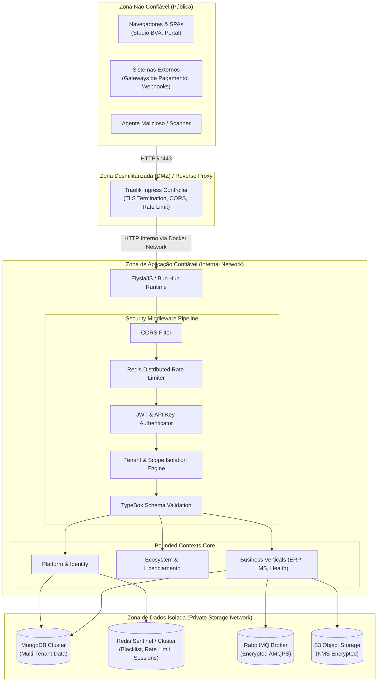
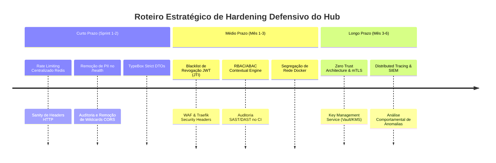

# Governança de Segurança e Engenharia Defensiva: Threat Model & Hardening Guide

> **Classificação:** Documento Técnico de Arquitetura e Segurança da Informação  
> **Sistema:** `m-manage` (Identity Gateway, App Store & Core Services Hub)  
> **Versão de Referência:** V0.10.56  
> **Responsável:** Staff Security Engineer & Architecture Committee  
> **Status:** Aprovado para Governança e Implementação  
> **Escopo:** Modelagem STRIDE, OWASP Top 10 API Security Risks, Plano de Hardening e Diretrizes de Secure Coding  

---

## 1. Sumário Executivo & Princípios de Segurança

O `m-manage` opera como o núcleo transacional e integrador de todo o ecossistema MirandaSoft / M-Platform. Por abrigar serviços críticos multi-tenant — incluindo faturamento ERP, prontuários de saúde (HealthTech), dados acadêmicos (M-Cursos LMS), pedidos de e-commerce e provisionamento de licenças —, sua superfície de ataque requer uma postura de **Defesa em Profundidade (Defense-in-Depth)** e adoção integral dos princípios **Zero Trust**:

1. **Nunca Confie, Sempre Verifique (Never Trust, Always Verify):** Toda requisição, seja proveniente de clientes públicos (Studio BVA, Web Portal) ou de integrações internas (Webhooks, Microfrontends), deve ser explicitamente autenticada, autorizada e validada contra o contexto de organização e unidade (`X-Organization-Id`, `X-Organization-Unit-Id`).
2. **Menor Privilégio (Least Privilege):** Usuários, API Keys e serviços só possuem acesso estrito aos recursos necessários para a sua operação delimitada pelo escopo da aplicação (`mAppAccess`) e permissões de perfil.
3. **Assunção de Violação (Assume Breach):** O desenho arquitetural presume que perímetros de rede podem falhar. A contenção lateral e a segregação estrita entre tenants em nível de banco de dados e camada de aplicação impedem a escalada vertical e horizontal.
4. **Resiliência e Fail-Safe Defaults:** Qualquer falha de autenticação, timeout de conexão ou inconsistência de payload deve resultar em bloqueio imediato (`HTTP 401/403/400`), sem exposição de stack traces ou detalhes de infraestrutura em ambientes produtivos.

---

## 2. Visão Geral da Arquitetura de Defesa e Fronteiras de Confiança

A arquitetura do `m-manage` é segmentada em quatro zonas de confiança primárias. Cada fronteira de confiança impõe mecanismos rígidos de inspeção e validação:



---

## 3. Modelagem de Ameaças: Metodologia STRIDE

Aplicando o modelo de ameaças **STRIDE** da Microsoft aos ativos do `m-manage`, identificamos os vetores de ataque específicos, os impactos e os controles defensivos mandatórios.

| Categoria STRIDE | Descrição da Ameaça no Hub | Vetor de Ataque no Contexto `m-manage` | Controles Defensivos Arquiteturais |
| :--- | :--- | :--- | :--- |
| **S**poofing *(Falsificação de Identidade)* | Um atacante se passa por um usuário legítimo, tenant ou microserviço. | - Roubo ou forjamento de JWTs (algoritmo `none`, chave fraca).<br/>- Assunção de tenant forjando headers `X-Organization-Id`.<br/>- Spoofing de webhook de pagamento. | - Assinatura assimétrica (RS256/EdDSA) ou HMAC SHA-256 com secrets de alta entropia (>= 256 bits).<br/>- O payload do JWT decodificado no servidor sobrepõe obrigatoriamente headers de tenant recebidos no request.<br/>- Validação de assinatura HMAC nos webhooks entrantes via secret compartilhado. |
| **T**ampering *(Adulteração de Dados)* | Modificação não autorizada de dados em repouso, em trânsito ou no payload de requisição. | - NoSQL Injection em queries Mongoose via `$where`, `$gt` ou `$regex`.<br/>- Adulteração de parâmetros de pedidos BVA ou balanço financeiro ERP.<br/>- Manipulação de dados de auditoria e LGPD. | - Strict schema binding com `@sinclair/typebox` descartando propriedades desconhecidas (`additionalProperties: false`).<br/>- Proibição absoluta de queries Mongoose construídas por concatenação ou passagem de `req.body` sem sanitização.<br/>- Tráfego interno cifrado (TLS/mTLS) e logs de auditoria imutáveis com hashing encadeado. |
| **R**epudiation *(Repúdio de Ações)* | Usuário ou operador nega ter executado uma operação crítica (ex: exclusão de tenant, baixa financeira). | - Falta de rastreabilidade de requisições sensíveis.<br/>- Logs genéricos sem vinculação de `userId`, `tenantId`, `ip` e `timestamp`. | - Logging estruturado contendo `correlationId` (UUIDv4), `userId`, `organizationId`, `clientIp` e `userAgent`.<br/>- Módulo de auditoria LGPD (`S011-audit-lgpd`) registrando trilha transacional imutável para eventos de escrita e exclusão. |
| **I**nformation Disclosure *(Vazamento de Informações)* | Exposição de dados sensíveis ou segredos do sistema para partes não autorizadas. | - Stack traces expostos no handler global de erro.<br/>- Vazamento de PII (CPF, senhas, dados médicos) em logs ou respostas de erro.<br/>- Enumeração de rotas no `/health` ou schemas de documentação em produção. | - Sanitização estrita no `onError` da Elysia: em produção, suprimir `error.message` e stack traces (apenas retorno padronizado e código de correlação).<br/>- Redação automática de campos sensíveis (`password`, `token`, `creditCard`, `documentNumber`) no middleware de logging.<br/>- Restrição da rota `/health` com detalhamento interno apenas para IPs da rede de monitoramento ou VPN administrativa. |
| **D**enial of Service *(Negação de Serviço)* | Esgotamento de recursos do Hub (CPU, memória, conexões de banco de dados). | - ReDoS (Regular Expression DoS) em validações TypeBox mal construídas.<br/>- Injeção de payloads gigantes de JSON ou uploads maliciosos multipart.<br/>- Flood de requisições de login/reset de senha sem rate limit. | - Limite máximo de body configurado na Elysia/Traefik (ex: 2MB para JSON, 15MB para upload multipart).<br/>- Rate limiting distribuído em Redis com janelas deslizantes (Sliding Window Log).<br/>- Timeouts agressivos de conexão HTTP, queries MongoDB (`maxTimeMS`) e filas AMQP. |
| **E**levation of Privilege *(Elevação de Privilégio)* | Usuário autenticado com perfil operacional acessa funções administrativas ou dados de outros tenants. | - BOLA / IDOR ao acessar `/api/v1/erp/invoices/:id` trocando o ID por outro tenant.<br/>- Parâmetro `role: 'admin'` injetado no payload de atualização cadastral (Mass Assignment).<br/>- Falha no middleware `requireAppAccess`. | - Validação combinada em nível de use case: `WHERE id = :id AND organizationId = :userOrgId`.<br/>- Schemas de DTOs de entrada bloqueiam estritamente campos sensíveis de controle de acesso (`role`, `permissions`, `isSuperAdmin`).<br/>- Guardas de rota declarativos com verificação explícita de `appId` e hierarquia de escopo. |

---

## 4. Matriz OWASP Top 10 API Security Risks (API Security Project)

Mapeamento rigoroso dos 10 riscos mais críticos de APIs modernas, contextualizados para o runtime Elysia + Bun e persistência MongoDB.

### API1:2023 - Broken Object Level Authorization (BOLA / IDOR)
* **Vulnerabilidade Teórica:** Um cliente autenticado altera o identificador (`id`, `orderId`, `patientId`) no path da URI e obtém acesso a registros de outra organização sem que o backend verifique se aquele objeto pertence à mesma `organizationId`.
* **Mecanismo de Defesa Arquitetural:**
  1. O repositório **nunca** deve executar buscas exclusivas por `_id` sem injetar o escopo de autorização:
     ```typescript
     // ❌ VULNERÁVEL
     await OrderModel.findById(orderId);

     //  SEGURO (Multi-Tenant Scoped)
     await OrderModel.findOne({
       _id: orderId,
       organizationId: currentSession.organizationId,
     });
     ```
  2. Implementação de camada de autorização baseada em contexto (Contextual Authorization Interactor) em todos os casos de uso.

### API2:2023 - Broken Authentication
* **Vulnerabilidade Teórica:** Senhas fracas, falta de bloqueio por força bruta, assinaturas JWT vulneráveis a tampering ou tokens que persistem válidos mesmo após logout.
* **Mecanismo de Defesa Arquitetural:**
  1. Armazenamento de senhas utilizando estritamente **Argon2id** ou **bcrypt** com fator de custo calibrado (mínimo 12 rounds para bcrypt).
  2. Assinatura de tokens JWT com expiração curta (máximo 15 a 60 minutos para Access Tokens) e Refresh Tokens rotativos com revogação via Redis Blacklist (`jti`).
  3. Rate limiting estrito na rota `/auth/login` (máximo 5 tentativas incorretas por IP/email por janela de 10 minutos).

### API3:2023 - Broken Object Property Level Authorization (Mass Assignment)
* **Vulnerabilidade Teórica:** Atacante envia atributos extras no body da requisição (ex: `{ "role": "superadmin", "status": "approved", "isVip": true }`) que são repassados cegamente para o método `.save()` ou `.update()` do Mongoose.
* **Mecanismo de Defesa Arquitetural:**
  1. Uso mandatório de DTOs TypeBox tipados com `additionalProperties: false`.
  2. Desestruturação explícita de campos permitidos na camada de Use Case / Controller; nunca fazer `Model.create(req.body)`.

### API4:2023 - Unrestricted Resource Consumption
* **Vulnerabilidade Teórica:** Paginações sem limite máximo (`/items?limit=1000000`) forçando o banco de dados a carregar gigabytes de dados na memória do Bun, gerando travamento por Out Of Memory (OOM).
* **Mecanismo de Defesa Arquitetural:**
  1. Paginação padrão com teto rígido: `const safeLimit = Math.min(Number(query.limit) || 20, 100);`.
  2. Timeouts estritos de execução no MongoDB (`maxTimeMS(5000)`).
  3. Definição explícita de quotas de requisição por segundo (RPS) por tenant em nível de API Gateway / Redis.

### API5:2023 - Broken Function Level Authorization (BFLA)
* **Vulnerabilidade Teórica:** Rotas administrativas (ex: `DELETE /api/v1/platform/tenants/:id`) acessíveis por usuários autenticados comuns porque o middleware valida apenas a presença do token, mas não a role ou escopo da função.
* **Mecanismo de Defesa Arquitetural:**
  1. Utilização combinada dos middlewares `requireAuth()` e `requireAppAccess('platform_admin')`.
  2. Verificação granular de permissões por ação (CRUD permissions matriz) via decorators na definição das rotas Elysia.

### API6:2023 - Unrestricted Access to Sensitive Business Flows
* **Vulnerabilidade Teórica:** Criação massiva de cadastros falsos, scraping de catálogo de produtos BVA, ou automação bot de pedidos sem verificação comportamental ou limites transacionais.
* **Mecanismo de Defesa Arquitetural:**
  1. Aplicação de Proof-of-Work ou CAPTCHA invisível (Cloudflare Turnstile) em formulários públicos de geração de leads.
  2. Limitação de velocidade comportamental (Velocity Checks) em fluxos de criação de pedidos e checkout.

### API7:2023 - Server-Side Request Forgery (SSRF)
* **Vulnerabilidade Teórica:** Funcionalidades de webhook ou importação de imagens onde a URL fornecida pelo usuário faz o servidor backend disparar requests HTTP para serviços internos (ex: `http://169.254.169.254/latest/meta-data/` da AWS, ou `http://localhost:27017` do MongoDB).
* **Mecanismo de Defesa Arquitetural:**
  1. Proibição de disparos HTTP para IPs privados (RFC 1918: `10.0.0.0/8`, `172.16.0.0/12`, `192.168.0.0/16`, `127.0.0.0/8`, `169.254.0.0/16`).
  2. Utilização de resolução DNS prévia e validação de IP via allowlist / verificação de socket antes do dispatch.
  3. Provedor de HTTP Client isolado com redirects desabilitados e timeout máximo de 3000ms.

### API8:2023 - Security Misconfiguration
* **Vulnerabilidade Teórica:** Exposição de headers `Server: Bun`, CORS configurado com wildcard `*` ou origens locais em ambiente de produção, credenciais default em arquivos `.env` commitados.
* **Mecanismo de Defesa Arquitetural:**
  1. Remoção de headers de fingerprinting (`X-Powered-By`, `Server`).
  2. CORS dinâmico e restrito baseado em variáveis de ambiente, nunca permitindo origens não seguras em `production`.
  3. Injeção de segredos via Secret Managers ou variáveis de ambiente Docker cifradas, com auditoria de integridade no boot da aplicação.

### API9:2023 - Improper Inventory Management
* **Vulnerabilidade Teórica:** Endpoints de teste ou versões antigas da API (ex: `/api/v1-beta/users`) deixados ativos sem os mesmos controles de segurança das versões correntes.
* **Mecanismo de Defesa Arquitetural:**
  1. Registro centralizado de serviços no Hub Service Registry (`apps/m-manage/src/hub`).
  2. Ciclo de vida explícito de APIs: Deprecated -> Sunset com cabeçalhos RFC 8594 (`Sunset`, `Deprecation`) e desativação programada.
  3. Geração contínua de especificação OpenAPI (Swagger) auditada contra as rotas reais montadas.

### API10:2023 - Unsafe Consumption of APIs
* **Vulnerabilidade Teórica:** O Hub confia cegamente em dados retornados por APIs de terceiros (ex: webhooks de gateway de pagamento, provedores de notas fiscais) sem validar tipos e tamanhos, tornando-se suscetível a injections de segunda ordem.
* **Mecanismo de Defesa Arquitetural:**
  1. Toda resposta de API externa deve ser validada contra um Schema TypeBox estrito antes de persistência ou processamento interno.
  2. Conexões de saída TLS estritas com validação de certificados CA válidos (proibição de `rejectUnauthorized: false`).

---

## 5. Plano de Ação de Hardening Defensivo



### 5.1. Curto Prazo (Ações Imediatas / 0 a 30 dias)

1. **Rate Limiting Centralizado via Redis:**
   - Implementar plugin de rate limiting na Elysia utilizando o cliente Redis já disponível (`ioredis`).
   - Política: 100 req/min para rotas gerais autenticadas; 10 req/min para rotas de autenticação (`/auth/*`) e recuperação de credenciais.
2. **Sanitização de Headers e Hardening de Erros:**
   - Adicionar middleware de segurança para injeção de headers defensivos:
     - `X-Content-Type-Options: nosniff`
     - `X-Frame-Options: DENY`
     - `Content-Security-Policy: default-src 'none'`
     - `Strict-Transport-Security: max-age=31536000; includeSubDomains; preload`
   - Refatorar a rota `/health` para expor status detalhado (host, memória, uptime) apenas sob autenticação interna ou VPN; clientes externos recebem unicamente `{ status: "ok" }`.
3. **Restrição Rigorosa de CORS por Ambiente:**
   - Separar a lista de origens CORS entre desenvolvimento (`localhost`, `.local`) e produção (`*.mirandasoft.com.br`, `studiobva.com.br`), impedindo que origens locais sejam válidas quando `NODE_ENV === 'production'`.
4. **Validação de Schemas TypeBox em 100% dos Endpoints de Escrita:**
   - Garantir que toda rota POST/PUT/PATCH possua `body` e `params` declarados via TypeBox com tipagem estrita, rejeitando campos excedentes.

### 5.2. Médio Prazo (30 a 90 dias)

1. **Mecanismo de Revogação de Tokens (Token Blacklist via Redis):**
   - Emitir JWTs contendo um identificador único `jti` (UUIDv4).
   - Ao executar `/auth/logout` ou alteração de senha/permissão, persistir o `jti` no Redis com TTL equivalente ao tempo restante de expiração do token.
   - O middleware `requireAuth` consulta o Redis (com cache in-memory de ultrabaixa latência) para validar a revogação.
2. **WAF & Traefik Middleware Stack:**
   - Configurar Traefik Middlewares para mitigação de slowloris, limitação de conexões concorrentes por IP e bloqueio de user-agents maliciosos conhecidos.
3. **Pipeline de Testes de Segurança Contínuos (DevSecOps):**
   - Integração de ferramentas SAST (ex: Semgrep, SonarQube) e auditoria de dependências (`bun audit` / Trivy para imagens Docker).
   - Bloqueio de PRs que introduzam dependências com CVEs de criticidade Alta ou Crítica.
4. **Segregação de Rede de Banco de Dados:**
   - Garantir que as instâncias de MongoDB, Redis e RabbitMQ estejam em redes internas Docker (`internal_nw`) sem portas expostas diretamente para o host público.

### 5.3. Longo Prazo (90 a 180 dias)

1. **Zero Trust & mTLS (Mutual TLS):**
   - Habilitação de autenticação mTLS entre o Ingress Controller (Traefik) e os serviços backend, bem como entre microsserviços do cluster.
2. **Key Management Service (HashiCorp Vault ou AWS KMS):**
   - Migração dos secrets em texto plano (`.env`) para um cofre centralizado com rotação automática de credenciais de banco e chaves criptográficas de JWT.
3. **SIEM & Detecção de Anomalias com OpenTelemetry:**
   - Exportação de logs estruturados e métricas de telemetria para Prometheus/Grafana Loki/OpenSearch.
   - Criação de alarmes para picos anormais de erros `401 Unauthorized`, `403 Forbidden` ou múltiplos acessos de IPs geodisparelhados para uma mesma conta em curto intervalo.

---

## 6. Diretrizes Práticas de Coding Seguro para o Hub

### 6.1. Prevenção de NoSQL Injection e Mass Assignment

* **Regra:** Nunca passe objetos brutos de `req.body` diretamente para construtores ou métodos de persistência do Mongoose.
* **Padrão Obrigatório:**

```typescript
import { Type, Static } from '@sinclair/typebox';

// 1. Definição estrita do contrato de entrada com TypeBox
export const CreateOrderDTO = Type.Object({
    customerName: Type.String({ minLength: 2, maxLength: 120 }),
    customerDocument: Type.String({ pattern: '^\\d{11}$|^\\d{14}$' }), // CPF ou CNPJ limpo
    items: Type.Array(Type.Object({
        productId: Type.String({ minLength: 12, maxLength: 36 }),
        quantity: Type.Integer({ minimum: 1, maximum: 500 }),
        unitPrice: Type.Number({ minimum: 0.01 })
    }), { minItems: 1, maxItems: 100 })
}, { additionalProperties: false });

export type CreateOrderInput = Static<typeof CreateOrderDTO>;

// 2. Controller & Use Case desacoplados com injeção segura de escopo
export async function executeCreateOrder(
    input: CreateOrderInput,
    tenantContext: { organizationId: string; userId: string }
) {
    // Sanitização e isolamento garantem que campos de governança pertencem ao contexto validado
    const newOrder = await OrderModel.create({
        organizationId: tenantContext.organizationId,
        createdBy: tenantContext.userId,
        customerName: input.customerName.trim(),
        customerDocument: input.customerDocument,
        items: input.items.map(item => ({
            productId: item.productId,
            quantity: item.quantity,
            unitPrice: item.unitPrice
        })),
        status: 'PENDING'
    });

    return newOrder;
}
```

### 6.2. Enforçamento de Contexto Multi-Tenant

Toda rota sob o contexto de negócio ou dados deve encadear a validação de sessão e de pertença de tenant:

```typescript
import { Elysia } from 'elysia';
import { requireAuth } from '../middleware/requireAuth';
import { requireAppAccess } from '../middleware/requireAppAccess';

export const erpFinanceRoutes = new Elysia({ prefix: '/api/v1/erp/finance' })
    .use(requireAuth)
    .use(requireAppAccess('erp_finance'))
    .get('/invoices/:id', async ({ params: { id }, user, set }) => {
        // Enforçamento mandatório: O filtro de consulta agrega a organizationId da sessão autenticada
        const invoice = await InvoiceModel.findOne({
            _id: id,
            organizationId: user.organizationId
        }).lean();

        if (!invoice) {
            set.status = 404;
            return { success: false, error: 'Fatura não encontrada' };
        }

        return { success: true, data: invoice };
    });
```

### 6.3. Proteção de Dados Sensíveis e Conformidade LGPD

* **Campos PII (Personally Identifiable Information):** CPF, CNPJ, dados de cartão de crédito e registros clínicos de saúde devem ser mascarados ao trafegar em logs:
  - Formato de mascaramento de CPF em logs: `***.456.789-**`.
  - Proibição absoluta de persistir números completos de cartão de crédito (PAN) ou CVV; utilizar unicamente referências de tokens dos adquirentes (ex: Pagar.me, Asaas, Stripe).
* **Segregação Lógica:** A exclusão de usuários e dados cadastrais deve disparar processo de anonimização reversa (direito ao esquecimento) respeitando as exigências fiscais de retenção mínima do ERP.

### 6.4. Consumo Seguro de APIs Externas e Mitigação de SSRF

Ao integrar webhooks de terceiros ou realizar chamadas HTTP externas:

1. **Validação de Endereço IP contra Redes Privadas:**

```typescript
import { isIP } from 'node:net';

const PRIVATE_SUBNETS = [
    /^127\./,
    /^10\./,
    /^172\.(1[6-9]|2[0-9]|3[0-1])\./,
    /^192\.168\./,
    /^169\.254\./,
    /^0\./
];

export function isSafeOutboundUrl(rawUrl: string): boolean {
    try {
        const parsed = new URL(rawUrl);
        if (parsed.protocol !== 'https:' && parsed.protocol !== 'http:') {
            return false;
        }

        const hostname = parsed.hostname;
        if (hostname === 'localhost' || hostname.endsWith('.local') || hostname.endsWith('.internal')) {
            return false;
        }

        if (isIP(hostname)) {
            for (const subnet of PRIVATE_SUBNETS) {
                if (subnet.test(hostname)) return false;
            }
        }

        return true;
    } catch {
        return false;
    }
}
```

2. **Validação Criptográfica de Webhooks Recebidos:**
   - Todo webhook assinado deve ter seu hash recalculado via `crypto.createHmac('sha256', webhookSecret).update(rawBody).digest('hex')` e comparado via `crypto.timingSafeEqual` para prevenir ataques de temporização (Timing Attacks).

---

## 7. Matriz de Auditoria e Conformidade Contínua

| Área de Controle | Mecanismo de Verificação | Frequência de Execução | Responsável |
| :--- | :--- | :--- | :--- |
| **Integridade de Secrets** | Scan de repositório git por chaves expostas (Gitleaks) | Pré-commit & CI Pipeline | DevSecOps |
| **Vulnerabilidade de Dependências** | Análise automatizada de CVEs (`bun audit` / Snyk) | Semanal & Todo Build | Staff Engineer |
| **Testes de Penetração (Pentest)** | Auditoria Black-Box e Gray-Box na API do Hub | Semestral | Consultoria Externa CISO |
| **Revisão de Permissões RBAC** | Auditoria de matriz de roles, tenants e usuários admin | Mensal | Security Committee |
| **Validação de Logs LGPD** | Checagem de integridade e retenção de logs de auditoria | Trimestral | DPO & Data Protection Officer |

---

## 8. Considerações Finais

A segurança do `m-manage` é um processo dinâmico e contínuo. As equipes que desenvolvem novas rotas, verticais ou microsserviços para o Hub devem submeter suas propostas arquiteturais à aprovação do Security Committee, garantindo que nenhum novo endpoint seja disponibilizado sem seu respectivo contrato TypeBox estrito, política de rate limit e isolamento multi-tenant comprovado.
